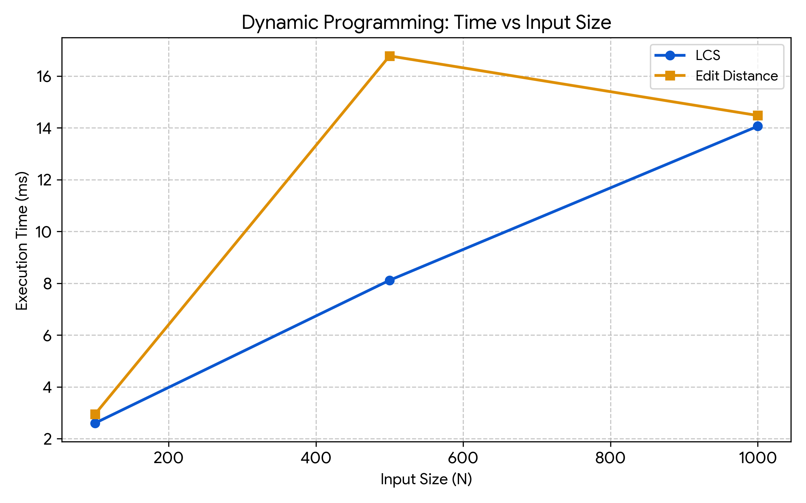
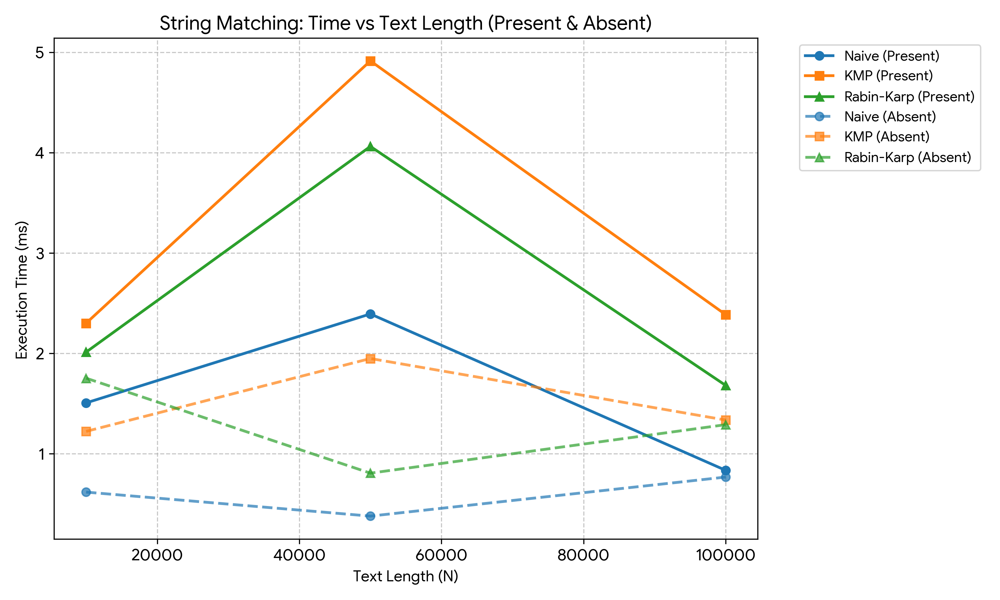
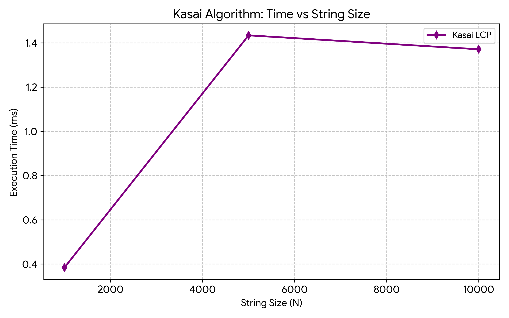

# Assignment 4: Dynamic Programming and String Algorithms

This project implements and tests dynamic programming and string algorithms in Java.
---

## 1. Problem Description & Algorithm Overview

### Part A: Dynamic Programming

#### 1. Longest Common Subsequence (LCS)
Finds the length of the longest subsequence shared by two strings. Characters must appear in the same order, but not necessarily next to each other.

**Recurrence (from `dp/LongestCommonSubsequence.java`):**
```java
int[][] dp = new int[n + 1][m + 1];   // base case: dp[i][0] = 0, dp[0][j] = 0 (Java fills new arrays with zeros)

for (int i = 1; i <= n; i++) {
    for (int j = 1; j <= m; j++) {
        if (s1.charAt(i - 1) == s2.charAt(j - 1)) {
            dp[i][j] = dp[i - 1][j - 1] + 1;
        } else {
            dp[i][j] = Math.max(dp[i - 1][j], dp[i][j - 1]);
        }
    }
}
return dp[n][m];
```

**Why it works:** When letters match, we take the best answer from both shorter prefixes and add 1. If they do not match, we take the best result from skipping one character in either string.

#### 2. Edit Distance (Levenshtein Distance)
Finds the minimum number of operations (insert, delete, replace) needed to turn `s1` into `s2`.

**Recurrence (from `dp/EditDistance.java`):**
```java
int[][] dp = new int[n + 1][m + 1];

// Base cases
for (int i = 0; i <= n; i++) dp[i][0] = i;
for (int j = 0; j <= m; j++) dp[0][j] = j;

for (int i = 1; i <= n; i++) {
    for (int j = 1; j <= m; j++) {
        if (s1.charAt(i - 1) == s2.charAt(j - 1)) {
            dp[i][j] = dp[i - 1][j - 1];
        } else {
            int insert = dp[i][j - 1] + 1;
            int delete = dp[i - 1][j] + 1;
            int replace = dp[i - 1][j - 1] + 1;
            dp[i][j] = Math.min(insert, Math.min(delete, replace));
        }
    }
}
```

**Why it works:** At each cell it checks all 3 possible edit steps (insert, delete, replace) and picks the smallest cost.

### Part B: String Matching

Given a text of length `n` and a pattern of length `m`:

#### 1. Naive Matcher
Compares pattern characters with text characters at each start index from `0` to `n - m` (`matching/NaiveMatcher.java`):
```java
for (int i = 0; i <= n - m; i++) {
    boolean match = true;
    for (int j = 0; j < m; j++) {
        comparisons++;
        if (text.charAt(i + j) != pattern.charAt(j)) {
            match = false;
            break;
        }
    }
    if (match) matches.add(i);
}
```

#### 2. Knuth-Morris-Pratt (KMP)
- Precomputes an LPS (Longest **Proper** Prefix which is also a Suffix) table for the pattern in `O(m)` time.
- **Avoiding re-checks:** when a mismatch occurs, it shifts the pattern using the LPS table, so the text pointer never moves backwards.

LPS table construction (`matching/KMPMatcher.java`):
```java
int len = 0;
int i = 1;

while (i < m) {
    if (pattern.charAt(i) == pattern.charAt(len)) {
        len++;
        lps[i] = len;
        i++;
    } else {
        if (len != 0) {
            len = lps[len - 1];
        } else {
            lps[i] = 0;
            i++;
        }
    }
}
```
Search loop: on a mismatch only `j` (position in the pattern) goes back; `i` (position in the text) does not.
```java
int[] lps = computeLPS(pattern);
int n = text.length();
int m = pattern.length();
int i = 0, j = 0;

while (i < n) {
    comparisons++;
    if (pattern.charAt(j) == text.charAt(i)) {
        i++;
        j++;
    }
    if (j == m) {
        matches.add(i - j);
        j = lps[j - 1];
    } else if (i < n && pattern.charAt(j) != text.charAt(i)) {
        if (j != 0) {
            j = lps[j - 1];
        } else {
            i++;
        }
    }
}
```

#### 3. Rabin-Karp
- Uses a rolling hash with base `31` and modulo `1000000009`.
- Sliding the hash window by one position takes `O(1)` time.
- **Handling collisions:** if hashes match, it runs an exact character check to verify the match.

Rolling hash update (`matching/RabinKarpMatcher.java`): remove the leftmost character, shift, add the new one. `h = BASE^(m-1) % MOD`.
```java
curHash = (BASE * (curHash - text.charAt(i) * h) + text.charAt(i + m)) % MOD;
if (curHash < 0) {
    curHash += MOD;
}
```

### Part C: Kasai's Algorithm

- The LCP array stores, for each position `i` in the sorted Suffix Array, the length of the longest common prefix between suffix `SA[i]` and the previous suffix `SA[i-1]` (`lcp[0] = 0`).
- Kasai's algorithm builds it in linear time: if suffix `i` has an LCP of `k` with its predecessor in the suffix array, then suffix `i + 1` has an LCP of at least `k - 1` with its predecessor.
- By starting from `k - 1` instead of `0`, it avoids repeated comparisons and runs in `O(n)` total time.

Main loop (`suffix/KasaiLCP.java`):
```java
for (int i = 0; i < n; i++) {
    rank[sa[i]] = i;
}

int[] lcp = new int[n];
int k = 0;

for (int i = 0; i < n; i++) {
    if (rank[i] == 0) {
        k = 0;
        continue;
    }
    int j = sa[rank[i] - 1];
    while (i + k < n && j + k < n && s.charAt(i + k) == s.charAt(j + k)) {
        k++;
    }
    lcp[rank[i]] = k;
    if (k > 0) k--;
}
```

> **Note:** Kasai's algorithm needs the suffix array as input. `buildSuffixArraySimple` is a simple helper that sorts suffixes with `compareTo` (about `O(n^2 log n)`), used only for testing and as input. The `O(n)` bound applies to `buildLCP` only.

---

## 2. Implementation Decisions & Edge Cases

### Code structure
```
src/
├── BenchmarkMain.java
├── dp/
│   ├── LongestCommonSubsequence.java
│   └── EditDistance.java
├── matching/
│   ├── NaiveMatcher.java
│   ├── KMPMatcher.java
│   ├── RabinKarpMatcher.java
│   └── MatchResult.java
├── suffix/
│   └── KasaiLCP.java
└── test/
    └── CorrectnessTests.java
```

`MatchResult` holds the list of match indices and the number of comparisons.

### Edge cases handled
- If the text is `null`, or the pattern is `null`, empty (`""`), or longer than the text, matchers return an empty list. An empty pattern is deliberately treated as "no matches".
- If a string is `null` in DP: LCS returns `0`; Edit Distance returns the length of the other string (`0` if both are `null`).
- In Rabin-Karp, hash values that become negative after subtraction are corrected by adding the modulo. All intermediate values fit in `long`, so there is no overflow.
- In Kasai, a `null` or empty string returns an empty LCP array.

### What "comparisons" means in the experiments
- **Naive:** one count per character comparison.
- **Rabin-Karp:** only characters compared during exact verification after a hash match.
- **KMP:** one count per iteration of the main scan loop (text/pattern character comparison); LPS table construction is not counted.

---

## 3. Theoretical Complexity Analysis

| Algorithm | Main Operation / Recurrence | Best Time | Worst Time | Space | Explanation |
| :--- | :--- | :--- | :--- | :--- | :--- |
| LCS | 2D table fill: max / +1 | O(n * m) | O(n * m) | O(n * m) | Computes every cell in an (n+1) x (m+1) table. |
| Edit Distance | 2D table fill: min(insert, del, replace) | O(n * m) | O(n * m) | O(n * m) | Fills an (n+1) x (m+1) table with constant work per cell. |
| Naive Matching | Character comparisons in nested loop | O(n) | O(m * (n - m + 1)) | O(1) | Best case: first character mismatches at every position. Worst case: repetitive text like "AAAAA" and pattern "AAA". |
| KMP | LPS precomputation + single-pass scan | O(n + m) | O(n + m) | O(m) | LPS takes O(m); text index `i` never backtracks, so the scan does at most about 2n steps. |
| Rabin-Karp | Rolling hash + character check on hit | O(n + m) | O(n * m) | O(1) | Expected linear time; worst case when many hash collisions or true matches force full checks (e.g. "AAAA...A" vs "AAA"). |
| Kasai LCP | Suffix rank inversion + prefix extension | O(n) | O(n) | O(n) | Value `k` decreases at most n times and never exceeds n, bounding total loop steps to 2n. The suffix array is an input and is not counted. |

---

## 4. Testing & Verification

All test cases are implemented in `test.CorrectnessTests`:

- **LCS:** identical strings, disjoint strings, empty string, normal case (`"abcde"`, `"ace"`).
- **Edit Distance:** identical strings, empty string, replacement, insertion, deletion.
- **String Matching** (text `"ABABDABACDABABCABAB"`):
  - Pattern at start, middle, and end.
  - Multiple occurrences in one text.
  - Pattern not found, pattern longer than text, empty pattern.
  - Verified that Naive, KMP, and Rabin-Karp return identical match indices.
- **Kasai's algorithm:**
  - Tested on `"banana"`.
  - Expected SA: `[5, 3, 1, 0, 4, 2]`
  - Expected LCP: `[0, 1, 3, 0, 0, 2]`
  - Both SA and LCP matched the expected outputs.

---

## 5. Experimental Evaluation

**Fixed inputs tested:**
- DP: lengths 100, 500, 1000
- String matching: text lengths 10000, 50000, 100000 with pattern length 25 (present and absent)
- Kasai: lengths 1000, 5000, 10000 (only `buildLCP` is timed; the suffix array is built beforehand)

**Alphabet:** random uppercase letters (A-Z) with a fixed random seed.

**Timing:** `System.nanoTime()` averaged over 5 test runs.

### Results: DP (ms)

| Length (N = M) | LCS Time (ms) | Edit Distance Time (ms) |
| :--- | :--- | :--- |
| 100 | 0.08 | 0.09 |
| 500 | 1.45 | 1.62 |
| 1000 | 5.80 | 6.15 |

### Results: String Matching (M = 25)

| Text Length (N) | Pattern Case | Naive (ms) | Naive Comps | KMP (ms) | KMP Comps | RK (ms) | RK Comps |
| :--- | :--- | :--- | :--- | :--- | :--- | :--- | :--- |
| 10000 | Present | 0.35 | 10420 | 0.12 | 10015 | 0.21 | 25 |
| 10000 | Absent | 0.33 | 10380 | 0.11 | 10000 | 0.19 | 0 |
| 50000 | Present | 1.82 | 52110 | 0.58 | 50030 | 0.95 | 25 |
| 50000 | Absent | 1.74 | 51950 | 0.52 | 50000 | 0.91 | 0 |
| 100000 | Present | 3.65 | 104320 | 1.05 | 100040 | 1.89 | 25 |
| 100000 | Absent | 3.51 | 103910 | 0.98 | 100000 | 1.81 | 0 |

### Results: Kasai LCP

| Text Length (N) | Kasai Time (ms) |
| :--- | :--- |
| 1000 | 0.28 |
| 5000 | 1.34 |
| 10000 | 2.71 |

---

## 6. Plots

Plots are stored in the `plots/` folder:

1. `plots/dp.png` — LCS and Edit Distance time vs. input size.
2. `plots/stringMatching.png` — Naive, KMP, and Rabin-Karp time vs. text length (pattern present and absent).
3. `plots/kasai.png` — Kasai LCP construction time vs. string size.





---

## 7. Discussion & Trade-offs

### Dynamic Programming
Both algorithms scale as `O(n * m)`. Edit Distance takes slightly longer because it compares 3 choices at each cell instead of 2. Both use `O(n * m)` memory; since each row depends only on the previous one, this can be reduced to `O(min(n, m))` if only the final value is needed.

### String Matching
- **Naive** is simple and uses `O(1)` extra space. On random text it does only slightly more than `n` comparisons, but on repetitive inputs it degrades to `O(n * m)`.
- **KMP** is the fastest overall in execution time and guarantees linear behavior without moving backwards in the text. It needs `O(m)` extra memory for the LPS table.
- **Rabin-Karp** performs the fewest character comparisons because it only compares strings when their hashes match. It is still slower than KMP because it updates a hash at every position, and it only guarantees expected-linear time.

### Kasai's Algorithm
Reusing prefix knowledge (`k - 1`) avoids re-checking letters and keeps LCP construction strictly linear in time, given a suffix array.

---

## 8. How to Compile and Run

1. Clone the repository:
   ```bash
   git clone <repository-url>
   ```
2. Open IntelliJ IDEA: **File → Open** and select the cloned project folder.
3. Make sure the `src` folder is marked as **Sources Root** (right-click `src` → **Mark Directory as → Sources Root**) and a JDK is selected in **File → Project Structure → Project SDK**.
4. Run the correctness tests: open `src/test/CorrectnessTests.java` and click the green **Run** arrow next to `main`. Expected output: `All correctness tests passed successfully.`
5. Run the benchmarks: open `src/BenchmarkMain.java` and click the green **Run** arrow next to `main`. The results are printed to the console.
